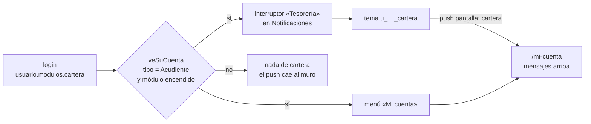

# Cartera — «Mi cuenta» de la familia en la app

El estado de cuenta de la familia con la tesorería, **sólo para leer**, y el
aviso push que lleva hasta él. Lo de tesorería —cobros, caja, acuerdos,
recordatorios— vive en la web (`/cartera` de app2). El plan del módulo está en
`myvc_front/docs/planes/PLAN-CARTERA.md`, §12 para la app.

Escrito el 8 oct 2026 contra `8myvc`. Lo que la app necesita —`modulos` en la
sesión, `cartera` en `TIPOS_DE_USUARIO` y `mi-cuenta`— **se desplegó a todos
los colegios ese mismo día con `82b17a56`**, con `MODULO_CARTERA` apagado: no
aparece en ninguno hasta que se encienda en su `.env`. Esta línea envejece;
lo que no envejece es medirlo (`tools/censo.sh` de 8myvc, y el `.env` del
colegio).

## Qué se decidió

- **Pantalla nativa y sólo lectura** (Joseth, 8 oct 2026). Pagar en línea se
  queda en la web: Wompi no se ha probado con dinero de verdad, y su retorno
  sólo acepta `https`, así que tras pagar la familia caería en la web sin
  sesión. Abrir la web desde el aviso se descartó porque obligaba a volver a
  entrar en el navegador.
- **En azul** (`#1677ff`, el de la maqueta «Lo que ve la familia» del prototipo
  de cartera), no en el morado de la casa: también decisión de Joseth. Es el
  mismo azul para todos los colegios. Ver `lib/Utils/EstiloCartera.dart`.
- Mismo orden y mismas frases que la web (`cartera/familia/mi-cuenta`), en
  «usted» como ella y como el aviso.

## Quién la ve: dos puertas, las mismas que el servidor

- **El módulo es del colegio, no de la app.** `MODULO_CARTERA` en el `.env` de
  cada colegio; el servidor lo manda en la sesión como `modulos: {cartera: true}`
  y `mi-cuenta` responde 404 sin él (`ExigirModulo`). No hay `Interruptores`:
  una sola app sirve a todos y sólo el servidor sabe cuál lo pagó. Un servidor
  sin la clave —uno de antes de `82b17a56`— es «no lo tiene».
- **El tipo es `Acudiente`, no el rol**: el controlador da 403 a cualquier otro.
- **`notificaciones/temas` manda `usuario.cartera` a todo el mundo**, docentes y
  colegios sin el módulo incluidos. Por eso `TipoDeAviso.disponible` filtra con
  `veSuCuenta`: el tema nunca recibiría nada, pero el interruptor prometería algo.

## Lo que no se ve en el código

- **No hay que refrescar `modulos` aparte**, aunque la sesión guardada sea una
  copia del login. El token de `login/credentials` dura **24 h fijas**
  (`sesion.legado_ttl`, `Sesion::abrirLegado`) y la app no llama a
  `auth/refresh`, así que nadie pasa más de un día sin volver a entrar, y cada
  entrada trae los módulos de ese momento. Encender el módulo en un colegio se
  ve, como mucho, al día siguiente. Se llegó a escribir un refresco semanal con
  `auth/me` y se quitó el mismo día: nunca habría llegado a dispararse. **Si la
  app empieza a refrescar el token**, esto vuelve a importar —aunque
  `sesion.maximo` lo ataría a siete días—.
- **Quien no responde por el pago** ve a sus hijos con «Al día» o «Pendiente» y
  la frase de la web, sin valores: el servidor le manda `cuentas: []`.
- **Privacidad**: la app pasa a mostrar información financiera. Los cambios a la
  política, al formulario de Play y a las etiquetas de App Store están escritos
  y **sin publicar** (bloques `⏸ CARTERA`); van en la misma tanda que la versión.

## Lo que falta

- Probarla a mano contra un colegio con `MODULO_CARTERA=true` y la rama del
  backend desplegada. Después, las pruebas (`MiCuentaScreen` ya acepta un
  `server` para el servidor de mentira).
- El recibo abierto (`mi-cuenta/recibos/{id}`) y pagar en línea: en la web.
