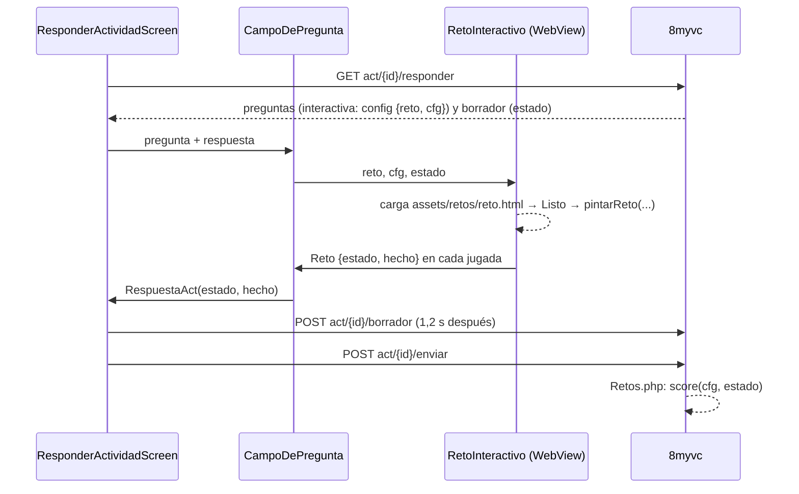
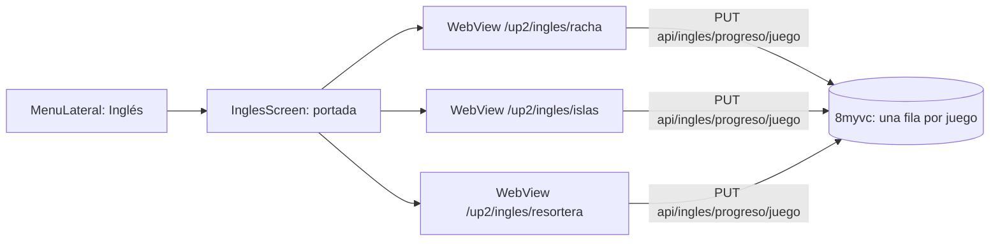

# English Quest en la app

La app sólo **juega**: responder las preguntas `interactiva` de Actividades y jugar la Racha,
las Islas y la Resortera de Coco. Crear cuestionarios o preguntas se hace en la plataforma
web (ver `app-diaria-web-administrativa`). El origen de todo está en myvc_front:
`docs/ingles-interactivo/` (PLAN.md, APP2.md) y `app2/src/app/comunes/act/retos/`.

## La decisión: mixta

Joseth la eligió el 2 de octubre de 2026, entre tres opciones: todo remoto, todo empaquetado
o mixta.

| Qué | Cómo | Por qué |
|---|---|---|
| Retos de Actividades | El motor va **dentro de la app** (`assets/retos/reto.html`), en una WebView que sólo pinta | Funciona sin red y sin pasar token, y guarda con el borrador/enviar que ya existe |
| Racha, Islas, Resortera | WebView con `https://<colegio>/up2/ingles/*` y la sesión de la app | Siguen siempre a la web, y el progreso es la misma fila que en el navegador |

Es la primera WebView de la app. Para YouTube se había descartado (`CampoDePregunta._video`)
porque era un paquete nativo para una sola clase de pregunta; aquí carga 33 retos y tres juegos
que no tiene sentido rehacer en Dart.

## Fase 1: preguntas interactivas (hecha)



- **La nota la pone el servidor** con su copia en PHP del motor (`app/Services/Act/Retos.php`). La app manda `estado` tal cual sale del motor y nunca
  manda un puntaje.
- `hecho` (el `done` del motor) sólo existe en la app y decide si la pregunta cuenta como
  respondida (`respuestaDada`, igual que `Recorrido::respondida`). Un estado que viene del
  borrador y no se ha jugado aquí se da por bueno; si no lo está, `enviar` responde 422 con la
  pregunta en `faltan`, y la pantalla salta a ella.
- **La voz**: WKWebView trae `speechSynthesis`, pero la WebView de Android no. La página le
  presta la de Dart (`flutter_tts`) por el canal `Voz`. Sin esto no se podrían jugar `escucha`
  ni `dictado`.
- **Gestos**: la WebView se queda con lo que empieza dentro de ella (arrastrar en pesca,
  cestas…). Mide como mucho el 75 % de la pantalla; si el reto es más alto, se desplaza por
  dentro.
- **Reducir movimiento**: el CSS del motor ya trae `prefers-reduced-motion`, y la WebView lo
  toma del sistema.
- En la versión web de la app no hay WebView, y la pregunta manda a la plataforma.

### Cuando cambia el motor en el front

```sh
node tools/retos/generar.mjs          # lee ../myvc_front; otra ruta como argumento
```

Esto regenera `assets/retos/reto.html`, que es la plantilla `tools/retos/plantilla.html` con
`motor.ts` y `estilos-del-motor.ts` dentro, y luego **se publica la app**. Un celular con un
motor viejo pinta el reto viejo, pero quien califica es el servidor. Si el front cambia el
`init`, el `done` o la forma del estado de un reto, coordinar con la sesión «Actividades
animadas» antes de desplegar el backend. Un reto que la app no conoce dice «actualízala o
responde en la web».

Probado en Chrome headless: los 33 retos se pintan, y con `solve` todos quedan `done`.

## Fase 2: los tres juegos (pendiente)



Lo que falta, y de quién es:

1. **Backend**: fundir y desplegar la rama `ingles-progreso` de 8myvc (commit e12e0bf4). Sin
   ella app2 guarda sólo en localStorage, y en la WebView eso se pierde.
2. **myvc_front, modo incrustado**: hoy app2 no tiene manera de recibir una sesión desde
   fuera. Sólo lee `xtoken`, `xrefresco` y `xtoken_expira` de su localStorage. Además, la app
   usa un token sin refresco, y si app2 intenta refrescarlo, acaba en el login. Hace falta que
   app2:
   - acepte la sesión inyectada sin `xrefresco` y no intente refrescarla;
   - esconda su menú y su barra cuando va dentro de la app, y que «volver» cierre la WebView;
   - no exija Google Fonts ni otra red aparte de la del colegio.
3. **App**: la entrada «Inglés» en `MenuLateral` (alumno y acudiente, detrás de un
   `Interruptores.ingles`), la ruta `/ingles` y la pantalla WebView. La pantalla inyecta la
   sesión con `runJavaScript` antes de cargar la ruta.

Lo que se arrastra en los juegos ya tiene alternativa de tocar en la web, y los finales nunca
humillan: lo trae app2, la app no lo toca.
