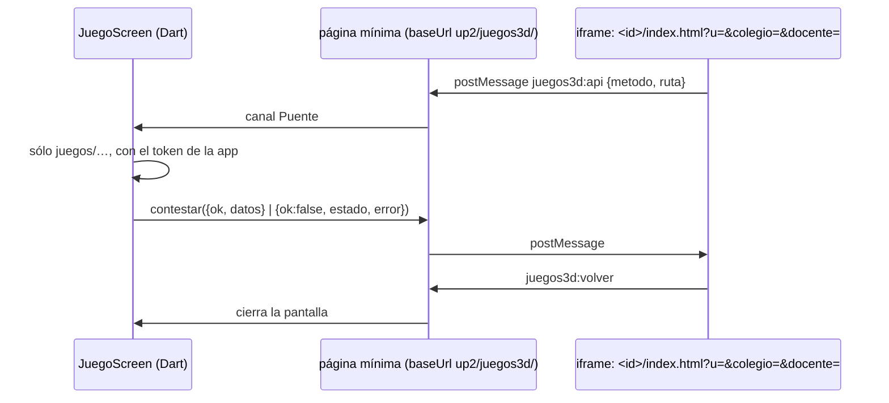

# Los juegos en la app

Los ocho juegos de la web (myvc_front `app2/src/app/paginas/juegos/juegos.ts`, `JUEGOS_3D`) se
abren en «Juegos», para todos: alumnos, familias y personal. La lista se copia a mano en
`lib/Http/JuegosApi.dart`. Cuando entre un juego en la web, se añade allí.

- **Por qué un iframe.** `puente.js` sólo se sabe «dentro de la app» cuando va en un iframe con
  `?u`, y habla con su padre comprobando que los dos tengan el mismo origen. El padre es una
  página mínima cargada con `baseUrl` en `<colegio>/up2/juegos3d/`, así que tiene el origen del
  colegio. El token nunca entra a la página: el juego pide y la app llama.
- `colegio` es `kPrimaryColor` en `#rrggbb`: la app no tiene color por colegio. `docente=1`
  va para el personal, que puede saltarse niveles. `juegos3d:grupos` le da al personal sus grupos
  del año (`GruposDelUsuario`) y a la familia `[]`.
- Las salas que abra un juego (`POST juegos/salas`) se borran al salir.
- **Destello** no es un estático del colegio: es `https://destello.pages.dev/`, sin puente ni
  `?u`. Se abre tal cual, en el modo de un jugador. Pesa decenas de MB, su audio todavía falla y
  el modo en grupo pide micrófono, que la WebView no concede. El botón de la barra lo abre en
  el navegador para jugar en grupo.

Interruptor: `Interruptores.juegos`, encendido. Los estáticos están en los dieciocho colegios
(medido en demo: `up2/juegos3d/three.min.js`, `puente.js` y `carrera/index.html` dan 200).
Pruebas: `test/juegos_test.dart`. **No se probó en un teléfono.**
